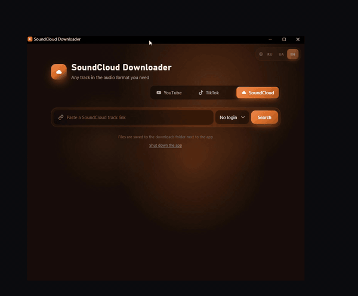
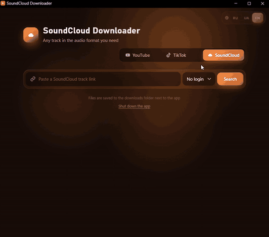
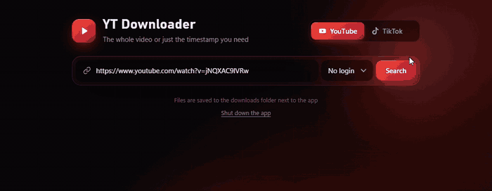
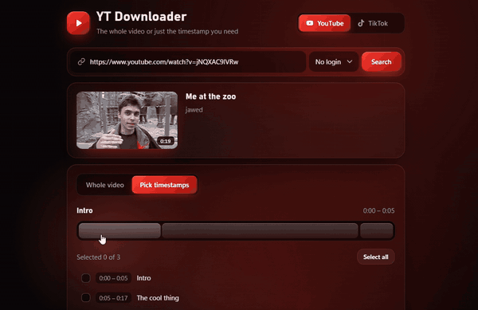
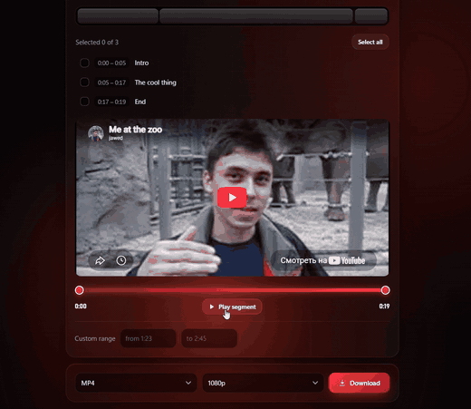
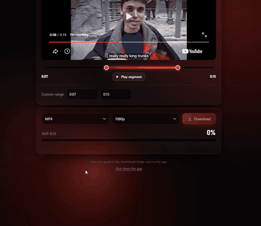

<!-- Dark + red theme. Palette: bg #0d0d0d, accent #e63946, text #e8e8e8 -->

<div align="center">


<a href="https://git.io/typing-svg">
  
</a>

<br/>


<br/>

<a href="https://github.com/caliguura/Clipper/releases/latest">
  
</a>

</div>

---

## 🩸 What is it?

**Clipper** is a small app that downloads videos and tracks from **YouTube**, **TikTok** and **SoundCloud** by link.
The main idea: you don't have to grab a whole 2-hour video when you only need one part of it.
Pick the timestamps (chapters) or set a custom range, preview the segment right in the app, and download only that.

Everything runs **on your own computer**: no accounts, no servers, no ads.

---

## 🆕 What's new

- 🟠 **SoundCloud support**: paste a track link and get it in the audio format you need
- 🪟 **Release version in its own window**: a ready-to-run Windows `.exe`, no browser tab, no Python, no setup
- 🎨 **Three themes**: the interface changes color with the service (red for YouTube, blue for TikTok, orange for SoundCloud)

👉 **[Get the latest release](https://github.com/caliguura/Clipper/releases/latest)**

---

## 🎬 See it in action

### 🪟 Its own window
The release version opens as a normal desktop window. Drag it around, resize it, minimize it, like any other app.

<div align="center">

</div>

### 🟠 Switch between services
One click on the service switch changes the mode and the whole look of the app.

<div align="center">

</div>

### 🔴 Search + choose how to log in
Paste a link and hit **Search**. You can also use cookies from your browser for videos that need a login.

<div align="center">

</div>

### ⏱️ Pick timestamps
The video is split into chapters. Click one or several segments, or hit **Select all**.

<div align="center">

</div>

### 👁️ Preview before you download
Drag the sliders to set an exact start and end, or type them into the custom range fields. **Play segment** shows exactly what you will get.

<div align="center">

</div>

### ⬇️ Download
Choose the format and quality, press **Download**, watch the progress. The file lands in the `downloads` folder next to the app.

<div align="center">

</div>

---

## ⚙️ Features

- 🎥 **YouTube, TikTok and SoundCloud** in one app
- 🎵 **SoundCloud tracks** in the audio format you choose
- ✂️ **Whole video or just a part**: chapters, multiple segments, or a custom time range
- 👁️ **Built-in preview** with draggable start/end sliders
- 🎚️ **Format and quality** selection before downloading
- 🍪 **Browser cookies** option (Firefox, Chrome, Edge, Brave, Opera, Vivaldi) for content that needs a login
- 🌍 **Three interface languages**: Russian, Ukrainian, English
- 🎨 **Adaptive design**: the theme changes with the selected service
- 🪟 **Standalone Windows app** (`.exe`) or run from source
- 🔒 **100% local**: files stay on your PC

---

## 🚀 Quick start

### Option 1: Windows release (easiest)

1. Open the **[Releases page](https://github.com/caliguura/Clipper/releases/latest)**.
2. Download the file from **Assets** (unpack it if it is a `.zip`).
3. Run the `.exe`. That's it.

> 💡 Windows SmartScreen may warn you about an app from an unknown publisher. Click **More info → Run anyway**.
> Downloaded files appear in the `downloads` folder next to the app.

### Option 2: Run from source

> Requires **Python 3.9+** and **FFmpeg** available in your PATH.

```bash
# 1. clone the repo
git clone https://github.com/caliguura/Clipper.git
cd Clipper

# 2. install dependencies
pip install -r requirements.txt

# 3. run
python app.py
```

Then open **http://127.0.0.1:5000** in your browser.

On Windows you can also double-click `run.bat` (or `launch.vbs` to start without a console window).
`create_shortcut.vbs` makes a desktop shortcut for you.

---

## 🧩 How it works

```
App window / browser (index.html)  ⇄  Flask server (app.py)  ⇄  yt-dlp  ⇄  YouTube / TikTok / SoundCloud
                                                │
                                                └──►  downloads/   (your finished files)
```

The interface sends the link to a tiny local Flask backend, which uses **yt-dlp** to read the info and download the chosen segment or track.
The Windows release is the same app packed into a single executable with PyInstaller.

---

## 📁 Project structure

```
Clipper/
├── assets/            screenshots and GIFs for this README
├── app.py             Flask backend + yt-dlp logic
├── index.html         the interface
├── icon.ico           app icon
├── build.py           builds the standalone .exe (PyInstaller)
├── build.bat          one-click build on Windows
├── run.bat            start the app on Windows
├── launch.vbs         start without a console window
├── create_shortcut.vbs  desktop shortcut
└── requirements.txt   Python dependencies
```

---

## 🗺️ Roadmap

- [x] YouTube downloading with timestamp selection
- [x] Segment preview with sliders
- [x] TikTok support with auto-detection
- [x] RU / UA / EN interface
- [x] SoundCloud support
- [x] Standalone Windows release (`.exe`)
- [ ] TikTok photo carousels (pick slides or all)
- [ ] More output formats (GIF, MKV and other popular video/audio formats)
- [ ] Download queue and playlists

---

## ⚠️ Disclaimer

This tool is made for **personal use** and learning. Download only content you have the right to save, and respect the terms of service of the platforms and the copyright of creators.

---

## 📬 Author

<div align="center">

Made by **[caliguura](https://github.com/caliguura)**. This is my first project, so feedback is very welcome!

[](https://t.me/dxmsprite)


⭐ If you like it, leave a star on the repo!


</div>
